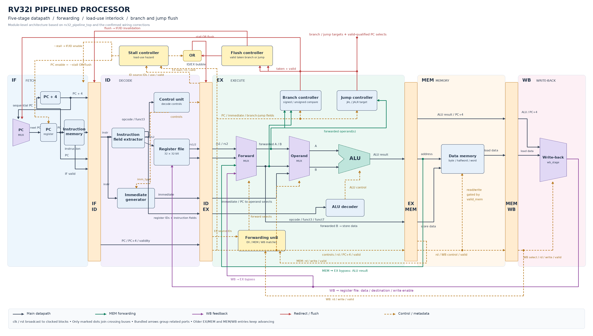
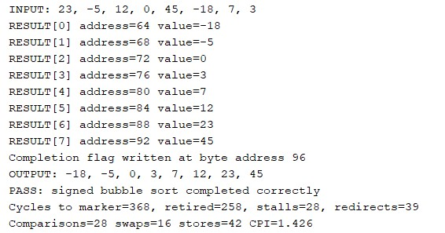

# RISC-V-5-Stage-Pipeline
# Five-Stage Pipelined RV32I Processor

A 32-bit RISC-V processor implemented in Verilog using a five-stage pipeline. The design includes operand forwarding, load-use hazard detection, and pipeline flushing to maintain correct execution across data and control dependencies.

## Architecture



| Stage | Function |
|-------|----------|
| **IF — Instruction Fetch** | Fetches instructions and selects the next PC. |
| **ID — Instruction Decode** | Decodes instructions, reads registers, and generates immediates. |
| **EX — Execute** | Performs ALU operations and resolves branches and jumps. |
| **MEM — Memory Access** | Handles data-memory reads and writes. |
| **WB — Write-back** | Writes ALU results, loaded data, or PC+4 into the register file. |

## Features

- RV32I integer arithmetic, logical, shift, and comparison operations.
- Byte, halfword, and word loads/stores with signed and unsigned loads.
- Conditional branches, JAL, JALR, LUI, and AUIPC.
- Separate instruction and data memories.
- MEM/WB operand forwarding to reduce data-hazard stalls.
- Load-use stalling that holds PC and IF/ID while inserting an EX bubble.
- Flushing of younger instructions when a valid branch or jump redirects execution.

## Verification

A self-checking regression passed tests for instruction results, register writes, memory stores, forwarding, stalling, and flushing. Coverage includes signed/unsigned comparisons, backward loops, jump return addresses, and suppression of wrong-path operations.

A signed bubble-sort application is included to demonstrate loads, stores, comparisons, loops, and hazard handling together.

```text
Input:   23, -5, 12, 0, 45, -18, 7, 3
Expected output: -18, -5, 0, 3, 7, 12, 23, 45
```

The bubble-sort testbench checks the sorted array through memory readback and reports execution cycles, stalls, redirects, and CPI.

